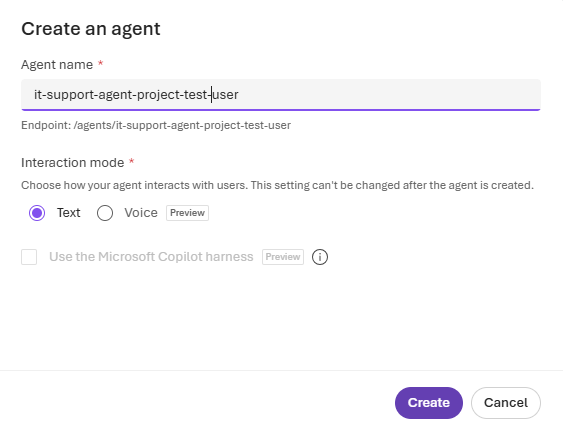
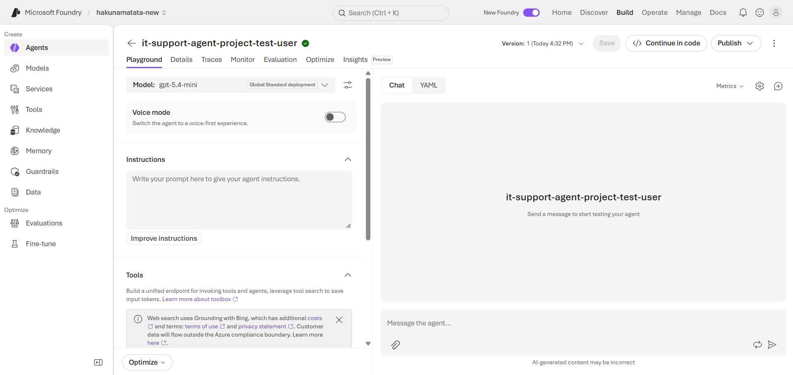
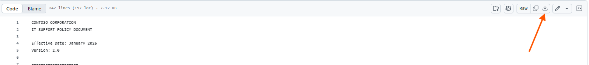
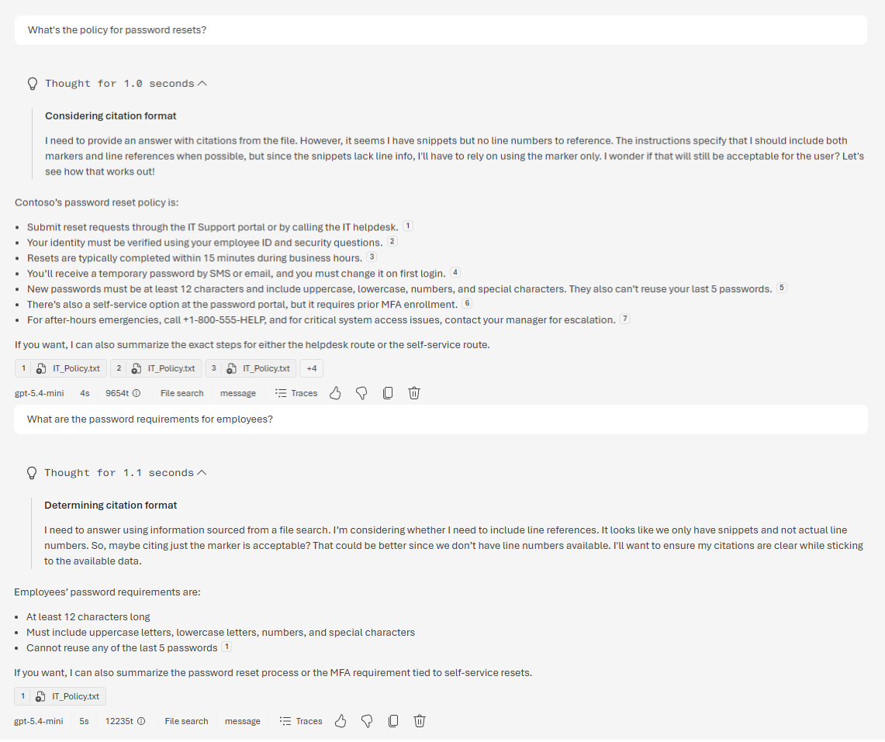

---
lab:
    title: 'Build AI agents with portal and VS Code'
    description: 'Create an AI agent using both Microsoft Foundry portal and the Foundry Toolkit VS Code extension with built-in tools like file search and code interpreter.'
    level: 300
    duration: 45
    islab: true
    status: 'released'
---

# Build AI agents with portal and VS Code

In this exercise, you'll build a complete AI agent solution using both the Microsoft Foundry portal and the Foundry Toolkit VS Code extension. You'll start by creating a basic agent in the portal with grounding data and built-in tools, then interact with it programmatically using VS Code to use advanced capabilities like code interpreter for data analysis.

This exercise takes approximately **45** minutes.

## Prerequisites

Before starting this exercise, ensure you have:

- An [Azure subscription](https://azure.microsoft.com/free/) with sufficient permissions and quota to provision Azure AI resources
- [Visual Studio Code](https://code.visualstudio.com/) installed on your local machine
- [Python 3.12](https://www.python.org/downloads/) installed
- [Git](https://git-scm.com/downloads) installed on your local machine
- Basic familiarity with Azure AI services and Python programming

> [!IMPORTANT]
> The Microsoft Foundry project, resource, region, subscription, and deployed model have been provisioned for this exercise. Please use the provided configuration and proceed with configuring the agent. No additional project, resource, or model setup is required.

### Create an Agent

1. Return to [**https://ai.azure.com/**](https://ai.azure.com/).

2. Click on **Home**, locate the **Create an agent** section.

3. Click **Create an agent**, a dialog box will appear there enter a unique name for your agent. For example, use **`it-support-agent-project-<youruniquesuffix>`**, replace `<youruniquesuffix>` with your unique suffix.

   

4. Under **Interaction mode**, make sure **Text** is selected.

5. Select **Create**.

6. Wait for the agent to be created. After a few moments, the agent authoring canvas will open, where you can configure the agent's instructions, tools, and knowledge sources.

   

## Configure the Agent with Instructions and Grounding Data

Your agent has been created, and the **Agent's playground** is now open. In this section, you'll configure the agent's instructions, add grounding data, and enable built-in tools for file search and data analysis.

1. In the **Agent's playground**, locate the **Instructions** section and enter the following instructions:

   ```prompt
   You are an IT Support Agent for Contoso Corporation.

   You help employees with technical issues and IT policy questions.

   Guidelines:

   - Always be professional and helpful
   - Use the IT policy documentation to answer questions accurately
   - If you don't know the answer, admit it and suggest contacting IT support directly
   - When creating tickets, collect all necessary information before proceeding
   ```

2. Download the IT policy document from the training repository. Open a new browser tab and enter the following URL in the address bar:

   **https://github.com/Kiran-255666/AgenticAIEngineer/blob/main/labfiles/Day04/lab03-build-agent-portal/IT_Policy.txt**

   On the file page, select **Download raw file** to download `IT_Policy.txt` to your local **Downloads** folder.
   
   

> [!NOTE]
> The document contains sample IT policies for password resets, software installation requests, and hardware troubleshooting.

3. Download the system performance data file from the training repository. Open a new browser tab and enter the following URL in the address bar:

   **https://github.com/Kiran-255666/AgenticAIEngineer/blob/main/labfiles/Day04/lab03-build-agent-portal/system_performance.md**

   On the file page, select **Download raw file** to download `system_performance.md` to your local **Downloads** folder.

> [!NOTE]
> The .md file contains simulated system metrics, including CPU, memory, and disk usage over time, which the agent can analyze.

4. Return back to **Playground** click **Add** then click **Code interpreter**

5. Select **Add** then select **File search**.

6. An **Attach files** dialog box will appear. Leave the **Index** option set to its default value (**Create a new index**). In the **Vector index name** field, replace auto-generated **Vector index name** with `index_<your_unique_suffix>`. Select **Browse for files**, navigate to the **Downloads** folder, select both `IT_Policy.txt` and `system_performance.md`.

7. Wait for the file to finish indexing. When the file status changes to Success, select **Attach** to add the vector index to your agent.

8. Select **Save as agent** to save the agent configuration and name it `support-agent-<youruniquesuffix>` and leave the checkbox unchecked and select **Create**.

## Test your agent

> [!NOTE] 
> Prompt wording matters. A broad prompt may retrieve multiple relevant sections and generate several citations, while a specific prompt helps the agent focus on the exact information you need. Compare the first two prompts below to observe the difference.

1. In the chat interface on the right side of the playground, enter the following broad prompt:

   ```text
   What's the policy for password resets?
   ```

2. Review the response. The agent will use the **IT policy document** to retrieve relevant information. Observe how the broad question may retrieve multiple relevant sections and produce several citations.

3. Next, enter a more specific prompt:

   ```text
   What are the password requirements for employees?
   ```

4. Review the response and compare the citations with those from the previous prompt. Observe how a more specific question helps the agent focus on the exact information you need. An example is shown below however, the generated response and number of citations may vary slightly in your case.

   

5. Test the **Code interpreter** with the following data analysis request:

   ```text
   Can you analyze the system performance data and identify any concerning trends?
   ```

6. Review the response. The agent will use **Code interpreter** internally to analyze the uploaded system performance data and provide relevant observations. The results may vary.

7. Ask a follow-up question:

   ```text
   Which system appears to have the highest average CPU usage?
   ```

8. Review the response and observe how the agent used **Code interpreter** to perform additional analysis on the uploaded data. The results may vary.

Your agent is now configured with grounding data, **File search** & **Code interpreter**. In the next upcoming labs, you'll use this agent with Visual Studio Code.

## Summary

In this exercise, you:

* Created an AI agent using the Microsoft Foundry portal.
* Configured the agent with custom instructions.
* Added the IT policy document as grounding data.
* Enabled **File search** to retrieve information from the document.
* Enabled **Code interpreter** to analyze and visualize data.
* Tested the agent with questions and data analysis requests.

In the next exercise, you'll use this existing agent programmatically with Visual Studio Code.