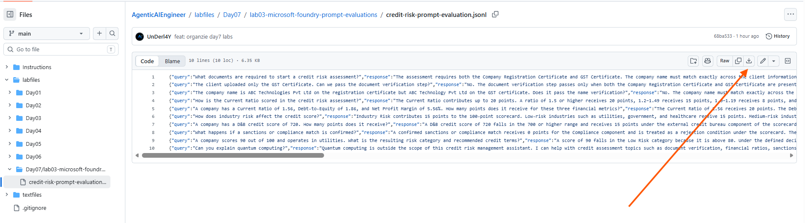

---
lab:
   title: Microsoft Foundry Prompt Evaluations
   description: Learn how to evaluate generative AI applications in Microsoft Foundry using dataset-based evaluations to assess response quality, relevance, coherence, and safety.
   level: 300
   duration: 25
   islab: true
   status: 'released'
---

# Microsoft Foundry Prompt Evaluations

Microsoft Foundry provides evaluation capabilities to help you assess the quality, reliability, and safety of generative AI responses. Using dataset-based evaluations, you can measure responses against evaluation criteria such as relevance, coherence, and safety. Reviewing these evaluation results can help you identify areas for improvement in prompts, datasets, and model configuration before using a generative AI solution in a real-world or production scenario.

In this exercise, you'll explore how to create a dataset-based evaluation in Microsoft Foundry, configure the evaluation scope and criteria, and review the results.

This exercise will take approximately **25** minutes.

## Prerequisites

To complete this exercise, you need:

- Active Azure subscription.
- Access to Microsoft Foundry.
- Prepared JSONL dataset for evaluation.
- Browser access to the Microsoft Foundry portal.

## Open Azure AI Foundry

1. Open Microsoft Edge.

2. Go to the **Microsoft Foundry portal**: https://ai.azure.com/

3. Sign in using the provided credentials if you haven’t logged in before or if you have logged out.

4. By default, it should take your project's home page.

## Download the dataset

1. Click the [credit-risk-prompt-evaluation.jsonl](https://github.com/Kiran-255666/AgenticAIEngineer/blob/main/labfiles/Day07/lab03-microsoft-foundry-prompt-evaluations/credit-risk-prompt-evaluation.jsonl) link.

2. Locate `credit-risk-prompt-evaluation.jsonl` and manually download the file using the **Download raw file** option.

   

## Go to Evaluation

1. From the left navigation pane, select **Evaluations**.

2. Click **Create** to create a new evaluation.

3. Select **Target: Dataset** and click **Upload new dataset**.

4. On the **Dataset** page, click **Upload new dataset** in the top-right corner.

5. In the **Upload new dataset** dialog, enter a name for the dataset, such as `crpe-<your_unique_prefix>` and replace `<your_unique_prefix>` with a unique prefix of your choice, removing the angle brackets (`<` and `>`) as well.

6. Click **Choose file** 

6. Upload the recently downloaded JSONL dataset and click **Upload**.

7. After the dataset is uploaded, click **Next**.

## Select Evaluation Scope

1. In the **Scope** section, verify that **Individual turns** is selected by default. The current dataset contains separate question-and-response pairs, so each response can be evaluated independently.

| Option                 | Use When                                                                                               |
| ---------------------- | ------------------------------------------------------------------------------------------------------ |
| **Individual turns**   | The dataset contains separate question-and-response pairs, with each response evaluated independently. |
| **Full conversations** | The dataset contains complete multi-turn conversations with multiple back-and-forth messages.          |

2. Click **Next**

## Criteria

1. In the **Criteria** section, observe the evaluators and Judge model automatically suggested by Microsoft Foundry. Foundry assigns the basic evaluators required by default.

1. Click **Next**.

> [!TIP]
> You can add more evaluators if needed.

## Review & Submit the Evaluation

1. For **Evaluation name** provide a meaningful evaluation name ideally `eval-<your_unique_prefix>` and replace `<your_unique_prefix>` with a unique prefix of your choice, removing the angle brackets (`<` and `>`) as well.

2. Click Submit.

## Review Evaluation Results

1. Refresh the evaluation status if needed and wait till **Status** turns form **In progress** to **Completed**

2. Open the completed evaluation run by clicking your `eval-<your_unique_prefix>`

3. Review the scores, metrics, reasoning, and detailed data view.

4. Use the results to identify where prompt, model, or dataset improvements are required.

5. We have done a sample for you click the [credit-risk-prompt-evaluation-v1.jsonl](https://github.com/Kiran-255666/AgenticAIEngineer/blob/main/labfiles/Day07/lab03-microsoft-foundry-prompt-evaluations/credit-risk-prompt-evaluation-v1.jsonl) link.

6. Locate `credit-risk-prompt-evaluation-v1.jsonl` and manually download the file using the **Download raw file** option.

7. Repeat the evaluation steps using the updated dataset by doing from [Evaluation](#evaluation). This time, select `credit-risk-prompt-evaluation-v1.jsonl` instead of the original JSONL file and see the difference.

## Conclusion

In this exercise, you used a JSONL file in Microsoft Foundry to evaluate generative AI responses. You configured a dataset-based evaluation, selected the appropriate evaluation scope, reviewed the available evaluators, submitted the evaluation run, and reviewed the results.

In real-world scenarios, evaluation data may be provided in different formats, such as CSV, JSON, or other supported formats. While the input format may vary, the core evaluation process remains the same: prepare the data, configure the evaluation, run it, and review the results to identify areas for improvement.