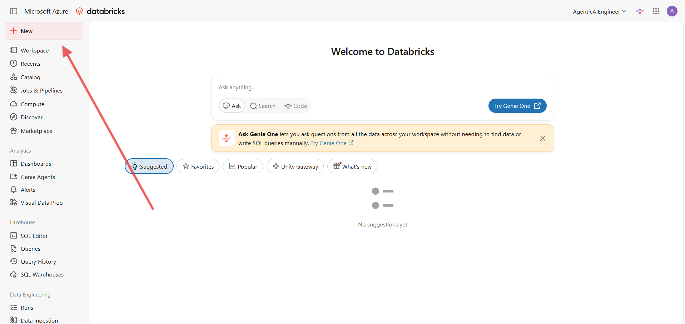
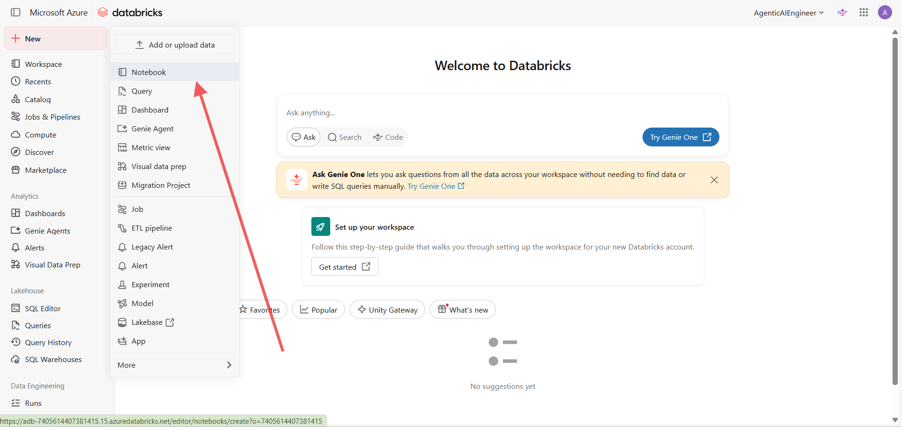
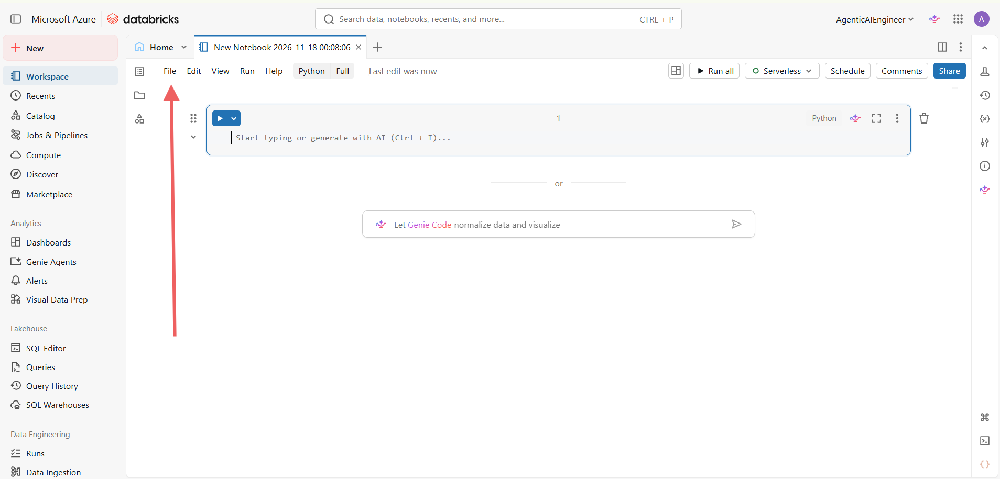
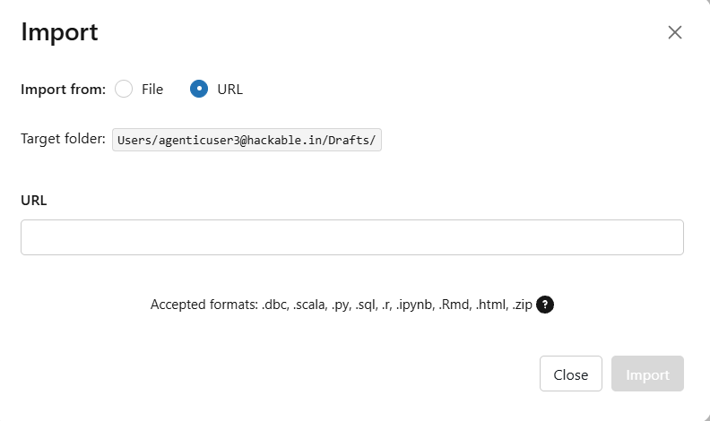

---
lab:
  title: Create and evaluate an AI agent
  description: Learn to build and evaluate an AI agent using Databricks, LangGraph, MLflow, and Unity Catalog.
  level: 200
  duration: 60
  islab: true
  status: 'released'
---

# Create and evaluate an AI agent

In this exercise, you will use Databricks to build and evaluate an AI agent that combines document retrieval and tool usage. You will work with a pre-chunked subset of Databricks documentation as your dataset.

This exercise takes approximately **60 minutes** to complete.

## Prerequisites

- Access to the assigned Databricks workspace.
- Access to the **Lab Credentials** sheet.
- Microsoft Edge or Google Chrome.
- Basic familiarity with Python and Jupyter notebooks.

## 1. Open the Databricks Workspace

1. Open [Azure Portal](https://portal.azure.com) in a new browser tab.
2. If you are already signed in with another account, sign out first.
3. When prompted to sign in, open the **Lab Credentials** sheet.
4. Find the row assigned to your **Participant Name**.
5. Copy your assigned **Databricks Account Username** and **Databricks Account Password**.
6. Return to Azure Portal and sign in using the assigned credentials.
7. Continue to your assigned Databricks workspace.

## 2. Access the Databricks Workspace

1. In Azure Portal, use the search bar at the top and search for **Azure Databricks**.
2. Select **Azure Databricks** from the search results.
3. Locate the **AgenticAIEngineer** workspace in the list of available Databricks services.
4. Click **AgenticAIEngineer** to open its overview page.
5. Click **Launch Workspace** to open the Databricks workspace in a new browser tab.

## 3. Import the Lab Notebook

1. Once the Databricks workspace opens, click **New** in the left navigation panel.


2. Select **Notebook** to create a new notebook.


3. In the newly opened notebook, click **File** and select **Import**.


4. Next to **Import from**, select **URL**.



5. Copy the following GitHub notebook URL and paste it into the **URL** field:

```
https://github.com/Kiran-255666/ai-agentic-engineer-msfoundry/blob/main/labfiles/Day08/lab03-create%20and%20evaluate-AI-agent.ipynb
```

6. Click **Import** to import the notebook into your Databricks workspace.

7. Once the import is complete, the lab notebook will open with the code and instructions ready to use.

## 4. Execute the Notebook

You can execute the notebook in two ways:

**Option 1: Run All**

- Click **Run All** at the top of the notebook to execute all cells sequentially.
- Review the code and outputs to understand the overall workflow.

**Option 2: Execute Cell by Cell (Recommended)**

- Read each code cell and its instructions before execution.
- Execute the cells one at a time using the run button next to each cell.
- Observe the outputs and understand what each step does.
- Follow the instructions and complete the hands-on exercises alongside the code.

**Recommendation:** Use the cell-by-cell approach to understand the implementation, follow the workflow, and gain practical experience rather than simply executing the entire notebook at once.

## 5. Lab Reference and Completion

You can also find the original lab notebook and its summary in the following GitHub repository:

[Lab Notebook – Create and Evaluate an AI Agent](https://github.com/Kiran-255666/ai-agentic-engineer-msfoundry/blob/main/labfiles/Day08/lab03-create%20and%20evaluate-AI-agent.ipynb)

The notebook includes the implementation, instructions, and a summary to help you understand the concepts covered.

**This completes the lab.**
